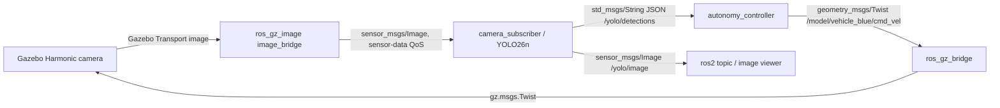

# ROS 2 機器人專案架構

## 主要資料流



## 套件與節點

### `robot_control`

- `camera_subscriber.py` 位於套件根目錄，`setup.py` 以 `py_modules` 安裝；目前不是 `robot_control/robot_control/` 子目錄中的檔案。
- Console entry point：`camera_yolo`。
- ROS 安裝啟動器使用系統 Python；節點在 import ROS/YOLO 前，把 `~/yolo_project/.venv/lib/python3.12/site-packages` 加入 Python module path。ROS 2 native modules 仍來自 `/opt/ros/jazzy`。
- `autonomous_controller.py` 含純 Python `AutonomyLogic` 和 ROS 2 `AutonomousController`。
- `move_robot.py`、`read_odom.py` 是手動運動及 odometry 範例節點。

### `yolo_ros`

這是較早期的靜態圖片 YOLO 範例：讀取固定圖片並發布文字結果。Gazebo 相機 Launch 使用 `robot_control/camera_yolo`，不使用該舊節點。

## 影像與辨識

- Gazebo camera topic：`/vehicle_blue/camera/image`，訊息 `sensor_msgs/msg/Image`；SDF 相機畫面為 640×480。
- `camera_yolo.launch.py` 啟動 `ros_gz_image/image_bridge`；ROS 相機 subscriber 使用 `qos_profile_sensor_data`（sensor-data best-effort QoS）。
- `cv_bridge.imgmsg_to_cv2(..., desired_encoding='bgr8')` 產生三通道 BGR ndarray。
- YOLO 模型預設：`/home/yulin/yolo_project/yolo26n.pt`；預設 conf 0.35；device `auto` 會傳入 `None`，目前 CUDA 不可用時實際選 CPU。
- 節點沒有 `classes` 過濾。推論後每個通過 YOLO conf 的框都會加進 detections。
- `/yolo/detections` 為 `std_msgs/msg/String`，內容 JSON 格式：

```json
{
  "stamp": {"sec": 0, "nanosec": 0},
  "frame_id": "camera_frame",
  "image_size": {"width": 640, "height": 480},
  "detections": [
    {
      "class_id": 41,
      "class_name": "cup",
      "confidence": 0.4988,
      "bbox_xyxy": [279.7, 257.9, 360.5, 419.4]
    }
  ]
}
```

- 無通過門檻的 boxes 時仍發布 JSON，`detections` 為空陣列。轉換或推論拋出例外時記錄錯誤並略過該影格。
- `/yolo/image` 為 `sensor_msgs/msg/Image`；標註影像使用 `bgr8`，保留輸入 header。

## 自主控制與安全行為

- Controller 訂閱 `/yolo/detections` (`std_msgs/msg/String`)；預設 target class 是 `bottle`。測試 cup 時需傳入 `target_class:=cup`。
- 每 0.1 秒發布 `geometry_msgs/msg/Twist` 到 `/model/vehicle_blue/cmd_vel`；`autonomous_yolo.launch.py` 用 `ros_gz_bridge` 對接 Gazebo DiffDrive。
- 無目標且資料新鮮時以設定速度限時搜尋；對準目標時轉向；接近狀態使用 `approach_speed`；目標達停止框比例後執行設定動作。
- 人員偵測會優先輸出停止指令。Detection 超過 `stale_timeout`（Launch 預設 1.0 秒）會安全停止；搜尋逾時及目標動作完成也輸出零速度。
- 本專案沒有為了診斷而更改上述控制器邏輯或速度參數。

## 目前 YOLO 差異除錯結論

- `/home/yulin/camera_test.jpg` 以模型、CPU、conf 0.35 推論可得 `cup 0.4988`。
- 同一解碼影像直接作 ndarray，及轉成 ROS `Image` 後經 cv_bridge 還原，均像素相同且輸出相同框/信心值。
- 在系統 Python 啟動路徑、由節點插入 venv site-packages 時，同樣輸出 `cup 0.4988`，runtime device 為 CPU。
- 這些檢查沒有讀取正在發布的 ROS camera topic；即時空 detections 的影格內容仍待單張 live-frame 擷取比對。
- 節點可透過 Launch 參數 `diagnostic_frame_path:=/tmp/yolo_live_frame.png` 擷取第一張原始 BGR frame。路徑必須是已存在目錄中的 `.png`，檔案已存在時不會覆寫。
