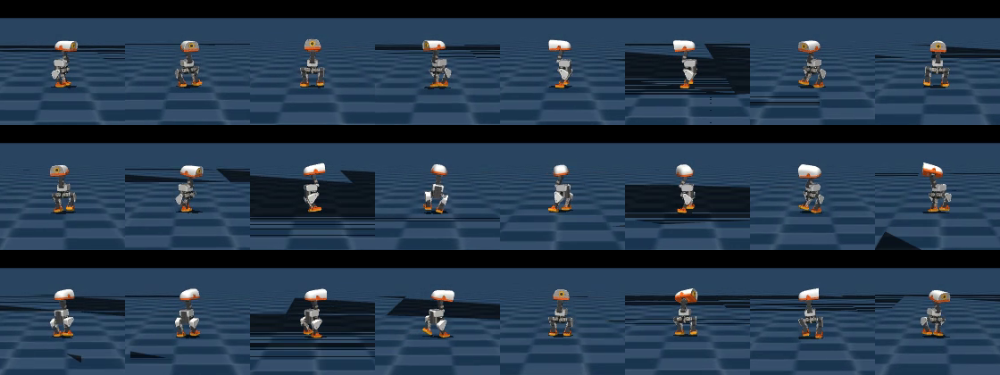

# microduck RL 研讀與重現（階段 4）

研讀 [pollen-robotics/microduck_rl](https://github.com/pollen-robotics/microduck_rl)，在本機（WSL2 + RTX 4070 Laptop 8 GB）重現平地行走策略的訓練。

這個資料夾只放我們自己的筆記和評估腳本。上游程式碼（Apache-2.0）沒有複製進來，機器人網格檔（STL，CC BY-NC-SA）也不能放進這個 repo。

## 環境

| 項目 | 內容 |
|---|---|
| 上游版本 | `0daab16`（develop 分支），clone 在 `~/rl/microduck_rl` |
| 套件管理 | uv 0.13.9（裝在 `~/rl/tools-venv`），`uv sync --locked` 建立 `.venv`（約 7.8 GB） |
| 主要套件 | mjlab 1.3.0、MuJoCo Warp、warp-lang 1.12、torch 2.9.1+cu128、rsl_rl（PPO） |
| 任務 | `Mjlab-Velocity-Flat-MicroDuck`（平地速度追蹤） |
| 規模 | 4096 個平行環境，VRAM 約 5.0 GB，每次迭代約 3.3 秒 |
| 紀錄 | TensorBoard（`--agent.logger tensorboard`），沒有使用 wandb，也沒有上傳任何東西 |

## 指令

在 `~/rl/microduck_rl` 執行。`UV` 指 `~/rl/tools-venv/bin/uv`。

```bash
# 訓練（第 1 輪，4000 次迭代）
$UV run --locked train Mjlab-Velocity-Flat-MicroDuck --env.scene.num-envs 4096 \
  --agent.max-iterations 4000 --agent.logger tensorboard --agent.run-name walk4096

# 從檢查點接續（再跑 2000 次迭代）
$UV run --locked train Mjlab-Velocity-Flat-MicroDuck --env.scene.num-envs 4096 \
  --agent.logger tensorboard --agent.resume True \
  --agent.load-run <run 資料夾> --agent.load-checkpoint model_<N>.pt \
  --agent.max-iterations 2000 --agent.run-name walk4096_resume

# 錄影（無視窗，640x480，500 步 = 10 秒）
MUJOCO_GL=egl timeout -k 10 330 $UV run --locked play Mjlab-Velocity-Flat-MicroDuck \
  --agent trained --checkpoint-file <run>/model_<N>.pt --num-envs 1 \
  --video True --video-length 500 --video-width 640 --video-height 480

# 匯出 ONNX（任務名稱是必要參數）
$UV run --locked python scripts/export.py Mjlab-Velocity-Flat-MicroDuck \
  --checkpoint-file <run>/model_<N>.pt --onnx-file ~/rl/exports/walk_<N>.onnx
```

注意事項：

- `play` 寫完影片後不會自己結束，要用 `timeout` 或手動停止。
- 不要在同一行指令裡用 `pkill -f` 比對 `play Mjlab` 或 `train Mjlab`，否則會把自己的 shell 也砍掉（exit 144）。
- 長時間訓練用 `setsid nohup ... &` 背景執行，關掉終端機也不會中斷。

評估腳本（在 `scripts/`，用上游的 `.venv/bin/python` 執行）：

- `tb_summary.py <run_dir> [step ...]`：列出獎勵、回合長度、速度誤差、跌倒次數。
- `make_strip.py out.png a.mp4 b.mp4`：每支影片取 N 張畫面拼成一張圖。
- `check_onnx.py model.onnx`：確認輸入輸出形狀和沒有 NaN。

## 訓練結果（2026-11-24 22:09 → 11-25 05:17，共約 7 小時）

| 輪次 | 迭代 | run 資料夾 |
|---|---|---|
| 1 | 0 → 3999 | `2026-11-24_22-09-32_walk4096` |
| 2 | 4000 → 5998 | `2026-11-25_01-40-53_walk4096_resume` |
| 3 | 5998 → 7997 | `2026-11-25_03-29-11_walk4096_resume2` |

| 迭代 | 平均獎勵 | 回合長度（上限 1000） | 線速度誤差 | 角速度誤差 | 跌倒 | 時間到 |
|---|---|---|---|---|---|---|
| 250 | 100.4 | 910 | 0.49 | 2.99 | 0.79 | 3.62 |
| 1000 | 118.8 | 971 | 0.47 | 1.72 | 0.38 | 4.54 |
| 2000 | 119.0 | 969 | 0.45 | 1.19 | 0.46 | 4.75 |
| 3998 | 111.3 | 942 | 0.43 | 1.15 | 0.62 | 4.67 |
| 5000 | 112.5 | 951 | 0.44 | 1.20 | 0.29 | 3.58 |
| 5997 | 112.6 | 942 | 0.42 | 1.10 | 0.50 | 3.79 |
| 7000 | 118.2 | 954 | 0.41 | 1.07 | 0.46 | 4.54 |
| 7996 | 108.4 | 899 | 0.41 | 1.06 | 0.62 | 3.25 |

「跌倒」和「時間到」是每個紀錄區間結束的回合數，數字會隨批次抖動。

觀察：

- 前 2000 次迭代進步最多：角速度誤差從 2.99 降到 1.19，回合幾乎都撐到上限。
- 2000 次以後指標進入平台期：線速度誤差在 0.41–0.45、角速度誤差在 1.06–1.20 之間，獎勵在 108–119 之間上下跳動。第 2、3 輪（多花約 3.5 小時）只帶來很小的改善。
- 獎勵沒有一路上升不代表變差：任務有課程學習（指令範圍會逐步放大），而且各批次的速度指令不同。

## 匯出的策略

`~/rl/exports/walk_3999.onnx`、`walk_5998.onnx`、`walk_7997.onnx`（不在 git 裡）。

三個檔案都是輸入 `[1, 61]`、輸出 `[1, 14]`，零輸入和隨機輸入都沒有 NaN。上游的匯出會過濾掉被動關節（`passive_*`），所以輸出是 14 個主動關節。

## 影片



由上到下是檢查點 3999、5998、7997。每一列是同一支 10 秒影片（500 步）平均取 8 張畫面，裁切在機器人附近。

- 三個檢查點在 10 秒內都保持直立，沒有跌倒。機器人會依指令轉向，所以每張畫面的朝向不同。
- 從靜態畫面看不出三者步態的明顯差異，這和指標的平台期一致。
- 影片在 `~/rl/play3999.mp4`、`play5998.mp4`、`play7997.mp4`（不在 git 裡）。

這些只是單次、10 秒的目視檢查，不是量化評估。

## 下一步

- 平地行走已經收斂，再加迭代意義不大。可以改試上游的其他任務（例如崎嶇地形），或調整指令範圍。
- 寫一個固定指令的評估（例如固定前進 0.2 m/s 跑 20 秒，量實際速度和跌倒次數），比訓練中的抖動指標更適合比較檢查點。
- 研讀上游的獎勵設計和觀測空間（61 維包含哪些量），對照實體 microduck 的部署流程。
