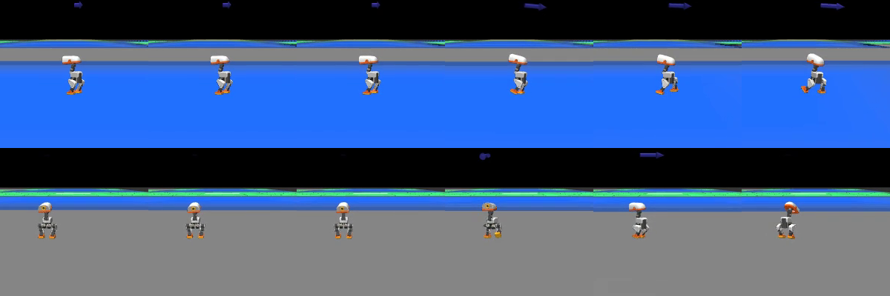

# microduck RL 研讀與重現（階段 4）

研讀 [pollen-robotics/microduck_rl](https://github.com/pollen-robotics/microduck_rl)，在本機（WSL2 + RTX 4070 Laptop 8 GB）重現平地行走策略的訓練。

這個資料夾只放我們自己的筆記和評估腳本。上游程式碼（Apache-2.0）沒有複製進來，機器人網格檔（STL，CC BY-NC-SA）也不能放進這個 repo。

## 環境

| 項目 | 內容 |
|---|---|
| 上游版本 | `0daab16`（develop 分支），clone 在 `~/rl/microduck_rl` |
| 套件管理 | uv 0.13.9（裝在 `~/rl/tools-venv`），`uv sync --locked` 建立 `.venv`（約 7.8 GB） |
| 主要套件 | mjlab 1.3.0、MuJoCo Warp、warp-lang 1.12、torch 2.9.1+cu128、rsl_rl（PPO） |
| 任務 | `Mjlab-Velocity-Flat-MicroDuck`（平地速度追蹤） |
| 規模 | 4096 個平行環境，VRAM 約 5.0 GB，每次迭代約 3.3 秒 |
| 紀錄 | TensorBoard（`--agent.logger tensorboard`），沒有使用 wandb，也沒有上傳任何東西 |

## 指令

在 `~/rl/microduck_rl` 執行。`UV` 指 `~/rl/tools-venv/bin/uv`。

```bash
# 訓練（第 1 輪，4000 次迭代）
$UV run --locked train Mjlab-Velocity-Flat-MicroDuck --env.scene.num-envs 4096 \
  --agent.max-iterations 4000 --agent.logger tensorboard --agent.run-name walk4096

# 從檢查點接續（再跑 2000 次迭代）
$UV run --locked train Mjlab-Velocity-Flat-MicroDuck --env.scene.num-envs 4096 \
  --agent.logger tensorboard --agent.resume True \
  --agent.load-run <run 資料夾> --agent.load-checkpoint model_<N>.pt \
  --agent.max-iterations 2000 --agent.run-name walk4096_resume

# 錄影（無視窗，640x480，500 步 = 10 秒）
MUJOCO_GL=egl timeout -k 10 330 $UV run --locked play Mjlab-Velocity-Flat-MicroDuck \
  --agent trained --checkpoint-file <run>/model_<N>.pt --num-envs 1 \
  --video True --video-length 500 --video-width 640 --video-height 480

# 匯出 ONNX（任務名稱是必要參數）
$UV run --locked python scripts/export.py Mjlab-Velocity-Flat-MicroDuck \
  --checkpoint-file <run>/model_<N>.pt --onnx-file ~/rl/exports/walk_<N>.onnx
```

注意事項：

- `play` 寫完影片後不會自己結束，要用 `timeout` 或手動停止。
- 不要在同一行指令裡用 `pkill -f` 比對 `play Mjlab` 或 `train Mjlab`，否則會把自己的 shell 也砍掉（exit 144）。
- 長時間訓練用 `setsid nohup ... &` 背景執行，關掉終端機也不會中斷。

評估腳本（在 `scripts/`，用上游的 `.venv/bin/python` 執行）：

- `tb_summary.py <run_dir> [step ...]`：列出獎勵、回合長度、速度誤差、跌倒次數。
- `make_strip.py out.png a.mp4 b.mp4`：每支影片取 N 張畫面拼成一張圖。
- `check_onnx.py model.onnx`：確認輸入輸出形狀和沒有 NaN。
- `eval_fixed_cmd.py --checkpoints ... [--pushes on]`：固定指令評估（見下方）。
- `train_tight_track.py`：用較嚴格的速度追蹤獎勵訓練（見「嘗試改善速度追蹤」）。
- `train_tracking_v2.py`：第二版速度追蹤實驗（見「研讀上游」）。
- `tb_to_csv.py <run_dir> out.csv`：把 TensorBoard 的所有數值匯出成 CSV。

原始紀錄在 `docs/raw_logs/`（gzip 壓縮，用 `zcat` 或解壓縮軟體開啟）：`train/` 是 4 次訓練的終端機輸出，`eval/` 是固定指令評估的輸出，`tensorboard_csv/` 是每次訓練全部的 TensorBoard 數值（step、tag、value）。

## 訓練結果（2026-11-24 22:09 → 11-25 05:17，共約 7 小時）

| 輪次 | 迭代 | run 資料夾 |
|---|---|---|
| 1 | 0 → 3999 | `2026-11-24_22-09-32_walk4096` |
| 2 | 4000 → 5998 | `2026-11-25_01-40-53_walk4096_resume` |
| 3 | 5998 → 7997 | `2026-11-25_03-29-11_walk4096_resume2` |

| 迭代 | 平均獎勵 | 回合長度（上限 1000） | 線速度誤差 | 角速度誤差 | 跌倒 | 時間到 |
|---|---|---|---|---|---|---|
| 250 | 100.4 | 910 | 0.49 | 2.99 | 0.79 | 3.62 |
| 1000 | 118.8 | 971 | 0.47 | 1.72 | 0.38 | 4.54 |
| 2000 | 119.0 | 969 | 0.45 | 1.19 | 0.46 | 4.75 |
| 3998 | 111.3 | 942 | 0.43 | 1.15 | 0.62 | 4.67 |
| 5000 | 112.5 | 951 | 0.44 | 1.20 | 0.29 | 3.58 |
| 5997 | 112.6 | 942 | 0.42 | 1.10 | 0.50 | 3.79 |
| 7000 | 118.2 | 954 | 0.41 | 1.07 | 0.46 | 4.54 |
| 7996 | 108.4 | 899 | 0.41 | 1.06 | 0.62 | 3.25 |

「跌倒」和「時間到」是 4096 個環境平均每一步結束的回合數（mjlab 的 `Episode_Termination/*`），會隨批次抖動。兩者相除可以估計跌倒比例：例如 0.5 ÷ (0.5 + 3.8) ≈ 12% 的回合以跌倒結束。訓練時每 3–6 秒會推機器人一次，還有質心和摩擦力的隨機化，所以這不等於平常走路的跌倒率。

觀察：

- 前 2000 次迭代進步最多：角速度誤差從 2.99 降到 1.19，回合幾乎都撐到上限。
- 2000 次以後指標進入平台期：線速度誤差在 0.41–0.45、角速度誤差在 1.06–1.20 之間，獎勵在 108–119 之間上下跳動。第 2、3 輪（多花約 3.5 小時）只帶來很小的改善。
- 獎勵沒有一路上升不代表變差。這個任務的速度指令範圍是固定的（前後 ±0.4 m/s、左右 ±0.3 m/s、轉向 ±1.0 rad/s），但有幾個課程學習項目會在前 2000 次迭代逐步加難，見下表。
- 1000 → 2000 次迭代之間，跌倒從 0.38 升到約 0.5，是因為任務本身變難了，不是策略退步。2000 次以後任務不再變化，之後的上下跳動是雜訊。
- 從檢查點接續訓練**不會**重設課程學習：mjlab 的 `MjlabOnPolicyRunner.load` 會還原步數計數器（`common_step_counter`），所以課程會從原本的位置接著走。只有設定 `MICRODUCK_WARM_START=1` 才會歸零，我們沒有設定。每輪第一筆紀錄的回合長度很短（例如 12），是因為接續時所有環境都重新開始，不是 bug。

| 課程學習項目 | 內容 | 到達最終階段 |
|---|---|---|
| `action_rate_weight` | 動作變化懲罰 -0.1 → -1.0（動作要更平順） | 第 1500 次迭代 |
| `standing_envs` | 指令為「站著不動」的環境比例 2% → 25% | 第 2000 次迭代 |
| `head_pose_range` | 頭部姿態指令範圍逐步放大 | 第 2000 次迭代 |
| `com_range`、`head_com_range` | 質心隨機化範圍逐步放大 | 第 1500 次迭代 |

課程學習是用步數計算的（每次迭代 24 步），例如 `500 * 24` 代表第 500 次迭代。

## 固定指令評估

訓練中的指標會跳動（指令隨機、課程學習、推力），不適合比較檢查點，所以另外寫了 `scripts/eval_fixed_cmd.py`：

- 每個檢查點都用同樣的固定速度指令，64 個環境各跑 20 秒，前 2 秒不計。
- 課程學習全部設在最終階段（和訓練結束時一樣），關掉「站著不動」和「原地轉」的指令分組，讓每個環境都拿到同一個指令。腳本會印出 `action_rate_w = -1.0` 確認課程確實在最終階段。
- 分成兩組：不推，以及 `play` 模式的推力（每 0.5–1 秒推一次，±0.3 m/s，比訓練時的 3–6 秒嚴苛很多）。
- 速度是機器人本體座標系的平均速度。另外用實際位移交叉驗證：指令 0.2 m/s 時平均速度 0.119、位移速度 0.114；指令 0.4 m/s 時 0.204 和 0.185，兩者一致，所以速度量測是對的。

原始結果：`docs/eval/fixed_cmd_push_off.json`、`fixed_cmd_push_on.json`。

### 跌倒（64 個環境中跌倒過的數量）

| 指令 (vx, vy, wz) | 1000 不推 | 3999 不推 | 5998 不推 | 7997 不推 | 1000 推 | 3999 推 | 5998 推 | 7997 推 |
|---|---|---|---|---|---|---|---|---|
| 前進 0.2 | 31 | 0 | 0 | 0 | 54 | 34 | 24 | 26 |
| 前進 0.4 | 24 | 0 | 0 | 0 | 59 | 31 | 22 | 18 |
| 後退 0.2 | 19 | 0 | 0 | 0 | 58 | 35 | 28 | 30 |
| 側移 0.2 | 26 | 0 | 0 | 0 | 57 | 38 | 27 | 31 |
| 轉向 0.8 rad/s | 23 | 0 | 0 | 0 | 55 | 38 | 28 | 35 |
| 站著不動 | 24 | 0 | 0 | 0 | 55 | 8 | 6 | 9 |

### 實際速度（不推）

| 指令 | 3999 | 5998 | 7997 |
|---|---|---|---|
| 前進 0.2 m/s | 0.126 | 0.126 | 0.119 |
| 前進 0.4 m/s | 0.228 | 0.219 | 0.212 |
| 後退 0.2 m/s | -0.036 | -0.038 | -0.041 |
| 側移 0.2 m/s | 0.037 | 0.041 | 0.032 |
| 轉向 0.8 rad/s | 0.511 | 0.577 | 0.549 |
| 站著不動（前進方向） | 0.043 | 0.042 | 0.040 |

### 結論

- **不推的時候很穩**：3999 以後的三個檢查點，6 種指令 × 64 個環境 × 20 秒，一次都沒有跌倒。1000 次迭代的檢查點約一半會跌倒（但它是在還沒走完課程時存的，在最終階段的條件下評估對它比較不利）。
- **第 2、3 輪有幫助，但只在抗推力上看得出來**：在頻繁推力下，5998 和 7997 走路時約每分鐘跌 1.1–2.2 次，3999 是 1.6–2.7 次。5998 和 7997 之間的差異在 64 個環境的樣本內分不出來。
- **速度明顯跟不上指令**，這是訓練指標看不出來的問題：前進只達到指令的 50–60%，後退只有約 20%，側移只有約 20%，轉向約 70%；站著不動時還會以 0.04 m/s 往前飄。
- 可能原因是追蹤獎勵太寬鬆：線速度追蹤是 `exp(-誤差²/0.1)`，前進 0.2 m/s 只走 0.12 m/s 時仍拿到約 94% 的追蹤獎勵，而走慢可以減少跌倒和動作懲罰。這是推論，還沒有用改過的獎勵重新訓練驗證。

## 嘗試改善速度追蹤（2026-11-25）

`scripts/train_tight_track.py` 註冊一個上游任務的副本 `Mjlab-Velocity-Flat-MicroDuck-TightTrack`，只把追蹤獎勵調嚴格（不改上游程式碼）：線速度 std² 0.1 → 0.05，角速度 std² 0.5 → 0.25。從 7997 接續訓練 2000 次迭代（07:49 → 09:37，run `2026-11-25_07-49-49_tight_track`，最後是 `model_9996.pt`），課程維持最終階段。

固定指令評估（同上，64 個環境 × 20 秒；原始結果 `docs/eval/tight_push_off.json`、`tight_push_on.json`）：

### 不推

| 指令 | 7997 本體速度 | 9996 本體速度 | 7997 位移速度 | 9996 位移速度 | 跌倒 |
|---|---|---|---|---|---|
| 前進 0.2 m/s | 0.120 | **0.164** | 0.111 | 0.132 | 都是 0 |
| 前進 0.4 m/s | 0.213 | **0.299** | 0.188 | 0.207 | 都是 0 |
| 後退 0.2 m/s | -0.042 | -0.042 | 0.060 | 0.073 | 都是 0 |
| 側移 0.2 m/s | 0.032 | 0.041 | 0.063 | 0.075 | 都是 0 |
| 轉向 0.8 rad/s | 0.551 | 0.513 | — | — | 都是 0 |
| 站著不動 | 0.040 | 0.056 | 0.039 | 0.053 | 都是 0 |

### 頻繁推力（每分鐘跌倒次數）

| 指令 | 7997 | 9000 | 9996 |
|---|---|---|---|
| 前進 0.2 | 1.92 | 1.22 | **0.94** |
| 前進 0.4 | 1.45 | 1.50 | 1.45 |
| 後退 0.2 | 2.16 | 1.73 | 1.64 |
| 側移 0.2 | 2.30 | 1.36 | 1.12 |
| 轉向 0.8 | 2.39 | 1.64 | 1.88 |
| 站著不動 | 0.42 | 0.28 | **0.09** |

### 結論

- **前進變快了**：本體速度從指令的 60% 提高到 82%（0.2 m/s）、從 53% 提高到 75%（0.4 m/s）。
- **但實際前進距離只多 10–20%**：本體速度和位移速度的差距變大（0.164 對 0.132），因為每隻機器人的朝向會慢慢偏掉，走成弧線。各環境的轉向誤差從 0.06 增加到 0.10–0.13 rad/s。
- **後退和側移沒有改善**，仍然只有指令的約 20%。（⚠ 2026-11-26 更正：受評估工具錯誤影響，見「夜間實驗（2026-11-26）」的「評估工具錯誤」）調追蹤獎勵解決不了，可能需要別的方法（例如提高這兩個方向的指令取樣比例，或確認機構本身是否限制了後退和側移）。這還沒驗證。
- **轉向變差一點**（0.55 → 0.51 rad/s），站著不動時往前飄得更多（0.04 → 0.056 m/s）。（⚠ 2026-11-26 更正：受評估工具錯誤影響，見「夜間實驗（2026-11-26）」的「評估工具錯誤」）
- **抗推力變好**：多數指令的跌倒次數下降，站著不動時從每分鐘 0.42 次降到 0.09 次。
- 總結：這次調整是「部分改善」。前進速度和抗推力變好，但直線保持、轉向和站立漂移變差，後退和側移不變。要拿去用的話，前進為主的場合用 9996，需要精準轉向或原地站立的場合，7997 比較穩。

## 研讀上游：為什麼走不快、後退和側移特別慢（2026-11-25）

讀上游的獎勵設定（`microduck_velocity_env_cfg.py`）和開發紀錄（`docs/velstand_policy.md`）後的發現：

1. **上游自己的實機策略也一樣慢。** 上游文件記錄，他們正在用的行走策略（`alpha_walking` 和 velstand v7／v8）指令 0.4 m/s 時只走 **0.17 m/s**。我們的 7997 是 0.21 m/s，調嚴獎勵後的 9996 是 0.30 m/s。所以「走不快」是這個機器人和任務設定本來就有的限制，不是我們的訓練出錯。
2. **側移慢，很可能是姿態獎勵限制了髖關節側擺。** 姿態獎勵（`pose`，權重 1.0）在走路時只允許 `hip_roll` 偏離預設姿態 **0.05 rad（約 3°）**。上游的註解寫這是刻意調緊的，為了避免腿往外張開。但側移主要靠 `hip_roll`。粗估：`hip_roll` 擺 0.1 rad 時，姿態獎勵從 1.0 掉到約 0.45；而側移從 0.04 追到 0.2 m/s 只能多拿約 0.45 的追蹤獎勵，所以策略選擇不側擺。這是推論，要用實驗驗證。
3. **上次「轉向變差」的原因找到了。** 上次把角速度追蹤的 std² 從 0.5 調成 0.25。上游在 `track_yaw_rate_fine` 的說明裡寫，他們試過一樣的做法，**轉向反而變差**（1.0 rad/s 時 0.42 → 0.16），因為太窄的高斯函數在誤差大時幾乎沒有梯度。他們的解法是**保留原本的項目，另外加一個窄的偏航項目**（`track_yaw_fine`，std 0.35，權重 2）。
4. **後退慢的原因沒有找到。**（⚠ 2026-11-26 更正：受評估工具錯誤影響，見「夜間實驗（2026-11-26）」的「評估工具錯誤」） 指令取樣是前後對稱的（±0.4 m/s），獎勵也沒有偏向前進。可能和機構（腳型、重心偏前）有關，上游文件沒有討論。

### 下一個實驗（`scripts/train_tracking_v2.py`）

| 實驗 | 線速度 std² | 角速度 std² | `track_yaw_fine` | `hip_roll` 走路容許值 | 目的 |
|---|---|---|---|---|---|
| A | 0.05 | 0.5（恢復上游） | 權重 2，std 0.35 | 0.05（上游） | 改善直線保持和轉向，保留前進速度 |
| B | 0.05 | 0.5 | 權重 2，std 0.35 | **0.08** | 驗證側擺限制是不是側移慢的原因 |

每個實驗從 7997 接續 2000 次迭代（約 1.8 小時），再用 `eval_fixed_cmd.py` 和 7997、9996 比較。站著不動時 `hip_roll` 仍維持 0.05，避免站姿變形。

### 實驗 A／B 結果（2026-11-25 20:42 → 11-26 00:24）

兩個實驗都從 7997 接續 2000 次迭代（A：`2026-11-25_20-42-20_track_v2_A`，B：`2026-11-25_22-22-24_track_v2_B`），用同樣的固定指令評估和 7997、9996（調嚴獎勵）比較。原始結果：`docs/eval/v2_push_off.json`、`v2_push_on.json`。

**不推（4 個版本 6 種指令都沒有跌倒）：**

| 指令 | 量測 | 7997 | 9996（調嚴） | **A** | B |
|---|---|---|---|---|---|
| 前進 0.2 m/s | 實際位移速度 | 0.105 | 0.132 | 0.119 | 0.086 |
| 前進 0.2 m/s | 偏航誤差（rad/s） | 0.067 | 0.093 | **0.026** | 0.022 |
| 前進 0.4 m/s | 實際位移速度 | 0.187 | 0.207 | **0.205** | 0.140 |
| 前進 0.4 m/s | 偏航誤差（rad/s） | 0.071 | 0.136 | **0.037** | 0.021 |
| 後退 0.2 m/s | 本體速度 | -0.041 | -0.042 | -0.026 | -0.031 |
| 側移 0.2 m/s | 本體速度 | 0.032 | 0.041 | **0.047** | 0.030 |
| 轉向 0.8 rad/s | 實際角速度 | 0.548 | 0.517 | **0.630** | 0.615 |
| 站著不動 | 漂移速度 | 0.040 | 0.056 | 0.040 | 0.028 |

**頻繁推力（每分鐘跌倒次數，越低越好）：**

| 指令 | 7997 | 9996 | **A** | B |
|---|---|---|---|---|
| 前進 0.2 | 1.41 | 0.94 | **0.70** | 0.80 |
| 前進 0.4 | 1.88 | 1.27 | **0.61** | 0.70 |
| 後退 0.2 | 2.34 | 1.83 | **1.27** | 2.25 |
| 側移 0.2 | 2.62 | 1.22 | **0.84** | 1.17 |
| 轉向 0.8 | 2.11 | 1.69 | **0.94** | 1.55 |
| 站著不動 | 0.38 | 0.23 | **0.09** | 0.23 |

**結論：**

- **A 是目前最好的版本。** 實際前進距離和 9996 一樣（0.4 m/s 時 0.205 對 0.207），但幾乎走直線：偏航誤差從 0.136 降到 0.037 rad/s。轉向是四個版本中最好的（0.63 rad/s，指令的 79%）。抗推力也最好，跌倒次數大約是 7997 的一半以下。這驗證了上游的做法：保留原本的轉向獎勵，另外加精細的偏航項目。
- **B 推翻了「側擺容許值限制側移」的假設。** 把走路時的 `hip_roll` 容許值從 0.05 放寬到 0.08 rad，側移反而沒有變快（0.030 對 A 的 0.047），前進也變慢、抗推力變差。側移慢的原因不是（或不只是）這個姿態限制。
- **後退和側移仍然只有指令的 15–25%**，這次的兩個實驗都沒有解決。（⚠ 2026-11-26 更正：受評估工具錯誤影響，見「夜間實驗（2026-11-26）」的「評估工具錯誤」）
- 部署建議用 A：`~/rl/exports/walk_v2_A_9996.onnx`（輸入 61、輸出 14、無 NaN）。（2026-11-26 更新：改用 C，見「夜間實驗」。）

## 夜間實驗（2026-11-26）

### 評估工具錯誤（已修正）

用新的指令反應探測工具（`scripts/probe_cmd_grid.py`）時發現，`eval_fixed_cmd.py` 沒有關掉 mjlab 預設的 `rel_forward_envs = 0.2`：每次重新取樣指令時，有 20% 的機器人會被改成「只往前走（vx ≥ 0.3）」。所以 2026-11-26 以前的固定指令評估，每個指令都混了約 20% 往前走的機器人：

- 「站著不動會往前飄 0.04 m/s」是**錯的**，機器人其實不會飄（修正後 0.000）。
- 「後退和側移只有指令的 15–25%」**低估了**，修正後後退約 45–55%。
- 各版本之間的比較大致仍成立（每個版本受到同樣的影響），但絕對數字不對。

工具已修正（關掉 `rel_forward_envs`、`rel_world_envs`、`init_velocity_prob`），所有版本都重新評估，結果在下面和 `docs/eval/fixed2_push_*.json`。上面較早的表格保留原樣當作紀錄，已標註更正。

### 真正的原因：訓練指令偏向前進

讀 mjlab 和 microduck 的指令設定後確認，訓練時的指令分佈是：站著不動 25%、**只往前走 20%**（mjlab 預設，microduck 沒有改）、原地轉 15%，剩下約 40% 才是前後、側移、轉向混合的隨機指令。後退只出現在隨機指令的一半，**純側移指令完全不會出現**（側移都和前後、轉向混在一起，平均只有 0.15 m/s）。`hip_roll` 的關節範圍是 ±0.38 rad，足夠側移，所以不是機構限制。

### 實驗 C（`scripts/train_tracking_v3.py`）

從實驗 A 接續 2000 次迭代（00:47 → 02:27，run `2026-11-26_00-47-33_track_v3_C`，`model_11995.pt`），在 A 的設定上：

- 關掉 20% 只往前走的指令（`rel_forward_envs = 0`）。
- 25% 的重新取樣改成純軸向指令：其中 70% 是純側移（|vy| 0.1–0.3 m/s），30% 是純後退（vx -0.1 到 -0.4 m/s）。
- 另外加一個窄的線速度追蹤項目（`track_lin_vel_fine`，std 0.15，權重 1），和 A 的 `track_yaw_fine` 同樣的想法。

### 修正後的評估：所有版本（不推，每項 64 隻 × 20 秒）

實際速度（括號是達到指令的比例）：

| 指令 | 7997 | 9996 調嚴 | A | B | **C** |
|---|---|---|---|---|---|
| 前進 0.2 m/s | 0.104 | 0.142 | 0.109 | 0.079 | **0.147（74%）** |
| 前進 0.4 m/s | 0.212 | **0.299** | 0.211 | 0.142 | 0.249（62%） |
| 後退 0.2 m/s | -0.106 | -0.128 | -0.086 | -0.077 | **-0.165（83%）** |
| 側移 0.2 m/s | 0.043 | 0.054 | 0.061 | 0.037 | **0.074（37%）** |
| 轉向 0.8 rad/s | 0.730 | 0.677 | **0.827** | 0.813 | 0.820（103%） |
| 站著不動 | 0.000 | 0.000 | 0.000 | 0.000 | 0.000 |
| 前進時偏航誤差（rad/s，0.4 m/s） | 0.071 | 0.137 | 0.036 | 0.020 | 0.040 |

5 個版本不推時都沒有跌倒。頻繁推力下每分鐘跌倒次數：

| 指令 | 7997 | 9996 | A | B | **C** |
|---|---|---|---|---|---|
| 前進 0.2 | 1.55 | 1.03 | 0.80 | 1.03 | **0.47** |
| 前進 0.4 | 1.41 | 1.36 | **0.56** | 0.80 | 0.75 |
| 後退 0.2 | 2.91 | 2.16 | 1.78 | 2.67 | **0.75** |
| 側移 0.2 | 2.44 | 0.94 | 1.31 | 1.50 | **0.56** |
| 轉向 0.8 | 3.14 | 1.22 | 1.41 | 0.89 | **0.33** |
| 站著不動 | 0.05 | 0.00 | 0.00 | 0.00 | 0.09 |

指令反應曲線（`probe_cmd_grid.py`，每個指令 16 隻，`docs/probe/*_sweep.json`），側移左右兩邊：

| 指令 | 7997 | A | **C** |
|---|---|---|---|
| 側移 +0.2 / +0.3 | 0.042 / 0.060 | 0.064 / 0.084 | **0.079 / 0.105** |
| 側移 -0.2 / -0.3 | -0.037 / -0.056 | -0.026 / -0.043 | **-0.073 / -0.102** |
| 後退 -0.2 / -0.4 | -0.105 / -0.220 | -0.086 / -0.179 | **-0.148 / -0.284** |

**結論：** C 是目前整體最好的版本。後退從約 45% 提高到 71–83%，側移提高約 2 倍、左右對稱了（A 往左只有往右的 40%），抗推力在大多數指令都最好，轉向維持約 100%。代價是小指令（≤ 0.1）的死區變大，而且原地小角速度（0.3 rad/s）轉不起來，這兩點用下面的指令校正表處理。側移仍然只有約 37%，是剩下最大的弱點。

### 創新：指令校正表（`scripts/cmd_remap.py`）

策略的反應是單調的，而且超出訓練範圍（例如前進 0.6 m/s）也不會跌倒，所以可以反過來：先量出「給多少指令會走多快」，再在部署時把想要的速度換成要給策略的指令。上游在實機上對轉向做過一樣的事（`docs/velstand_policy.md` 的 anchor yaw remap），這裡推廣到三個軸。

做法：`probe_cmd_grid.py` 量 31 個指令的反應 → `cmd_remap.py build` 對每個軸、每個方向做單調的分段線性反函數 → `cmd_remap.py validate` 用同一組目標速度，分別給原始指令和校正後的指令，比較實際速度。

C 的驗證結果（`docs/probe/C_remap_validate.json`，每個目標 16 隻、量 13 秒）：

| 目標 | 不校正 | 校正後 |
|---|---|---|
| 前進 0.20 m/s | 0.138 | **0.203** |
| 前進 0.10 m/s | 0.000（死區） | **0.131** |
| 後退 0.10 m/s | 0.002（死區） | **0.101** |
| 後退 0.15 m/s | 0.038 | **0.166** |
| 側移 +0.09 m/s | 0.000（死區） | **0.089** |
| 側移 +0.06 m/s | 0.001 | **0.066** |
| 轉向 0.6 rad/s | 0.493 | **0.626** |
| 轉向 0.3 rad/s | 0.035 | **0.235** |

單一軸的平均誤差：前後 0.086 → **0.032**，側移 0.056 → **0.023**，轉向 0.148 → **0.053** m/s 或 rad/s，都降了 60% 以上，校正後沒有跌倒。A 也有同樣的效果（0.094 → 0.043、0.055 → 0.028、0.119 → 0.064）。

限制：

- 很小的目標（側移 0.03、後退 0.05、轉向 0.15）還是在死區邊緣，達不到。
- 表是逐軸校正的。前進加轉向一起時，轉向會過頭（目標 0.3 rad/s 得到 0.43），因為兩個軸會互相影響；要更準需要二維的校正表。
- 能走的最快速度不會因為校正而提高：C 往前最多約 0.3 m/s、側移約 0.1 m/s（`docs/probe/C_remap.json` 的 `max_achievable`）。
- 只在模擬中驗證過，實機上的反應曲線需要重新量。

### 實驗 D：崎嶇地形（失敗）

上游的崎嶇地形任務（`Mjlab-Velocity-Rough-MicroDuck`）和平地任務的觀測完全相同（不看地形，是「盲走」），所以可以直接從 C 接續。D 用 C 的所有設定，加上 `ROUGH=1`，接續 3000 次迭代（03:04 → 05:16，run `2026-11-26_03-04-48_track_v3_D_rough`，`model_14994.pt`）。

8 GB 顯示卡在崎嶇地形放不下 4096 或 2048 個環境（記憶體不足／CUDA graph 建立失敗），只能用 1024 個，每次迭代的資料量是平地的 1/4。

崎嶇地形評估（不推，每項 64 隻 × 20 秒，`docs/eval/roughACD_push_off.json`），速度／每分鐘跌倒：

| 指令 | A | **C** | D |
|---|---|---|---|
| 前進 0.2 | 0.119／0.14 | **0.141／0.09** | 0.122／0.00 |
| 前進 0.4 | 0.252／1.03 | **0.260**／0.80 | 0.239／**0.70** |
| 後退 0.2 | -0.086／0.05 | **-0.166**／0.80 | -0.028／0.14 |
| 側移 0.2 | 0.058／0.19 | **0.076／0.09** | 0.067／0.28 |
| 轉向 0.8 | 0.892／0.00 | **0.939／0.00** | 0.576／0.00 |

平地評估（`docs/eval/flatCD_push_*.json`）：D 的後退從 C 的 -0.165 掉到 -0.030，轉向從 0.82 掉到 0.45 rad/s。

**結論：D 失敗，C 仍是最好的版本。** D 沒有比 C 更穩，反而把後退和轉向「忘掉」了，比較像是變保守（少動就少跌）。可能原因：只能用 1/4 的環境數、地形課程讓任務變難，以及接續訓練時沒有重新調整各獎勵的比重；沒有時間做對照實驗確認。值得注意的是，**C 沒有在崎嶇地形上訓練過，卻已經能在上面走**：前進、側移、轉向都和平地差不多，不推時跌倒最多每分鐘 0.8 次（後退 0.2 m/s 時最多，是 C 在崎嶇地形上最弱的地方）。



影片：`~/rl/play_rough_C.mp4`、`~/rl/play_rough_D.mp4`（不在 git 裡，`play` 模式每 0.5–1 秒推一次）。

### 實驗 E：更多純側移指令（2026-11-28，失敗）

C 的側移最多只有約 0.13 m/s（指令 0.2 時只到 37%）。假設：C 的訓練指令裡純側移只占約 17%（25% 純軸向 × 70% 側移），再提高比例就會更快。E 用 C 的所有設定，把純軸向指令提高到 40%、其中 80% 是純側移（純側移約 32%），從 C 的 `model_11995.pt` 接續 2000 次迭代（00:46 → 02:23，run `2026-11-28_00-46-12_track_v3_E`，`model_13994.pt`，`scripts/run_night_e.sh`）。

事先定的成功標準：側移 0.2 m/s 指令至少達到 0.1 m/s（50%），前進、後退、轉向退步不超過 10%，跌倒不增加。

平地評估（每項 64 隻 × 20 秒，`docs/eval/flatCE_push_*.json`），本體速度：

| 指令 | C（不推） | E（不推） | C 跌倒（推） | E 跌倒（推） |
|---|---|---|---|---|
| 前進 0.2 | 0.146 | 0.148 | 7 | 12 |
| 前進 0.4 | 0.249 | 0.256 | 13 | 15 |
| 後退 0.2 | **-0.165** | -0.114 | 10 | 6 |
| 側移 0.2 | 0.075 | 0.074 | **14** | 27 |
| 轉向 0.8 | 0.819 | 0.770 | 8 | 13 |
| 站立 | 0.000 | 0.000 | 0 | 1 |

指令反應曲線（`docs/probe/E_sweep.json`）：側移指令 0.2／0.3／0.4／0.5 時，C 走 0.079／0.105／0.128／0.142，E 走 0.074／0.103／0.119／0.135 m/s。

**結論：E 失敗，C 仍是最好的版本。** 側移完全沒有變快，後退變慢 31%，有推力時跌倒從 52 次增加到 74 次。這推翻了「側移慢是因為指令比例太低」的假設：C 已經學到它在這個設定下能做到的側移速度（最多約 0.13–0.14 m/s），再多的側移指令只讓其他方向變差。下一步應該研究步態本身（側移時的踏步寬度、`hip_roll` 實際用到多少），而不是再調指令比例。

### 目前的建議

- **部署用 C**：`~/rl/exports/walk_v3_C_11995.onnx`（輸入 61、輸出 14、無 NaN），搭配指令校正表 `docs/probe/C_remap.json`。
- 剩下的弱點：側移最多約 0.13 m/s（0.2 指令時 37%；實驗 E 證實不是指令比例造成的）、極小指令的死區、前進加轉向一起時校正表會讓轉向過頭、崎嶇地形上後退較容易跌倒。

## 匯出的策略

`~/rl/exports/walk_3999.onnx`、`walk_5998.onnx`、`walk_7997.onnx`（不在 git 裡）。

三個檔案都是輸入 `[1, 61]`、輸出 `[1, 14]`，零輸入和隨機輸入都沒有 NaN。上游的匯出會過濾掉被動關節（`passive_*`），所以輸出是 14 個主動關節。

## 影片


> 圖中的機器人是用 [Pollen Robotics](https://github.com/pollen-robotics/microduck_rl) 的 microduck 3D 模型在模擬中渲染的。模型採用 [CC BY-NC-SA 4.0](https://creativecommons.org/licenses/by-nc-sa/4.0/) 授權，這張圖（模擬畫面截圖，經裁切拼接）同樣以 CC BY-NC-SA 4.0 授權，僅供非商業用途。

由上到下是檢查點 3999、5998、7997。每一列是同一支 10 秒影片（500 步）平均取 8 張畫面，裁切在機器人附近。

- 三個檢查點在 10 秒內都保持直立，沒有跌倒。機器人會依指令轉向，所以每張畫面的朝向不同。
- `play` 模式每 0.5–1 秒就推機器人一次（訓練時是 3–6 秒），比訓練更嚴苛，但它的課程學習從第 0 階段開始（最簡單）。
- 從靜態畫面看不出三者步態的明顯差異，這和指標的平台期一致。
- 影片在 `~/rl/play3999.mp4`、`play5998.mp4`、`play7997.mp4`（不在 git 裡）。

這些只是單次、10 秒的目視檢查，不是量化評估。

## 下一步

- 平地行走已經收斂，再加迭代意義不大。可以改試上游的其他任務（例如崎嶇地形），或調整指令範圍。
- 速度追蹤：只調嚴追蹤獎勵已經試過（見上方），前進有改善但後退和側移沒有。下一步可以試：加一個懲罰朝向偏移的項目、提高後退和側移指令的取樣比例，或研讀上游怎麼處理這個問題。
- 研讀上游的獎勵設計和觀測空間（61 維包含哪些量），對照實體 microduck 的部署流程。
