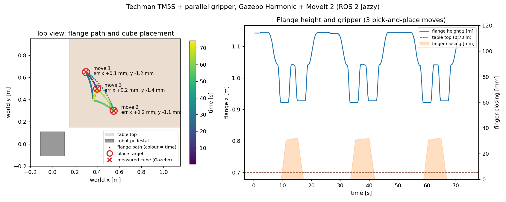
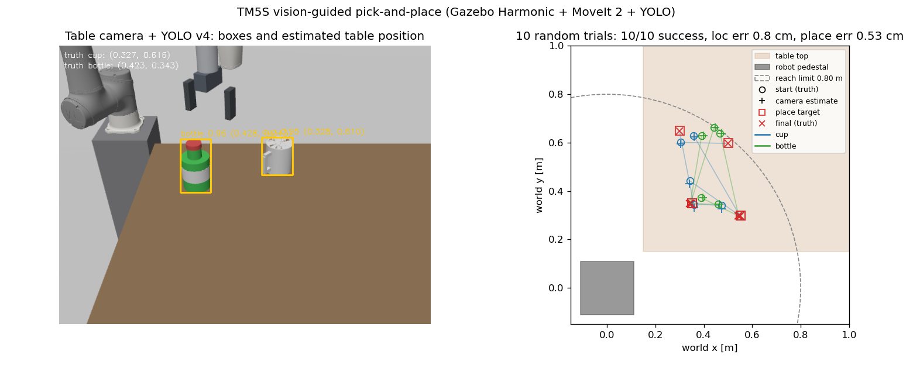

# 達明 TM5S-900：Gazebo + MoveIt 2 取放

依經理建議，不用 Isaac Sim，改沿用 UR5e 專案已經架好的 Gazebo Harmonic + MoveIt 2（ROS 2 Jazzy），完成達明 TM5S（臂長 900 mm 等級）的關節控制、末端控制和取放。



## 結果（2026-11-25）

| 項目 | 結果 |
|---|---|
| 控制器 | `joint_state_broadcaster`、`tmr_arm_controller`、`parallel_gripper_controller` 全部 active |
| 關節控制（3 個關節目標） | 全部成功，誤差 ≤ 0.0046 rad |
| 末端控制（夾取前姿態） | 目標 (0.400, 0.500, 1.042)，實際 (0.400, 0.501, 1.044)，誤差約 2 mm |
| 連續 3 次取放 | 3/3 成功，Gazebo 實測方塊誤差 0.1–1.4 mm |

連續取放的紀錄（`docs/evidence_2026-11-25/results.csv`）：

| 次數 | 從 → 到 | 實測位置 | 誤差 x | 誤差 y |
|---|---|---|---|---|
| 1 | (0.40, 0.50) → (0.30, 0.65) | (0.3001, 0.6488) | +0.1 mm | -1.2 mm |
| 2 | (0.30, 0.65) → (0.55, 0.30) | (0.5502, 0.2989) | +0.2 mm | -1.1 mm |
| 3 | (0.55, 0.30) → (0.40, 0.50) | (0.4002, 0.4986) | +0.2 mm | -1.4 mm |

錄 GUI 影片那次（Gazebo + RViz）也是 3/3 成功，誤差 0.0–1.4 mm，紀錄在 `docs/evidence_2026-11-25_gui_video/`。

證據：`docs/evidence_2026-11-25/` 有每次取放的 log、末端路徑（`flange_path.csv.gz`，20 Hz）、啟動 log 和上面的圖。

## 視覺引導取放（2026-11-27）

物體位置不事先告訴手臂：固定相機拍桌面 → YOLO 找到杯子和瓶子 → 換算成桌面座標 → TM5S 到估計的位置夾取，放到指定位置。整體規劃見 `docs/plan_vision_agent.md`（A～C 已完成）。



### 結果

| 項目 | 驗收標準 | 結果 |
|---|---|---|
| 偵測（20 次隨機擺放） | 都偵測得到 | 杯子 20/20、瓶子 20/20，最低信心值 0.94 |
| 定位誤差 | 平均 ≤ 1.5 cm、最大 ≤ 3 cm | 杯子平均 0.95 cm、瓶子 0.61 cm，最大 1.41 cm |
| 視覺引導取放（10 次隨機擺放） | ≥ 8/10 | 第 1 輪 9/10，修正工作範圍後第 2 輪 **10/10** |
| 放置誤差（成功的） | ≤ 2 cm、直立、另一個物體不動 | 平均 0.53 cm，全部直立，另一個物體都沒動 |

每次取放約 25 秒。紀錄在 `docs/evidence_2026-11-27_vision/`（`localization_*.json`、`trials_run*.json`、每次取放的 log）。

### 做法

| 步驟 | 內容 |
|---|---|
| 場景 | `scripts/make_vision_world.py` 產生 `vision_world.sdf`：桌子遠端（+x）高 1.45 m 的固定相機往下約 36° 看；杯子和瓶子用 YOLO 訓練資料同樣的基本形狀，加上碰撞與質量，直徑都是 9 cm（夾爪開口 12.2 cm） |
| 偵測 | YOLO v4（`~/yolo_project/yolo26n_gazebo_v4_table.pt`，見下方） |
| 定位 | `scripts/detect_objects.py`：由視角算相機內參，偵測框中心 → 射線 → 和「物體中間高度」的水平面求交點（杯子 5.25 cm、瓶子 8 cm）。相機位置固定在世界裡，模擬中不需要另外校正 |
| 夾取 | `pick_place_demo.py` 擴充：圓柱物體、依半徑算夾取寬度（接觸點再夾 5 mm）、依高度算夾取高度（夾爪本體高於物體頂端 5 mm）、另一個物體加入碰撞場景 |
| 驗證 | `scripts/validate_localization.py`、`scripts/vision_pick_trials.py`：用 Gazebo 真實位置判斷，手臂只拿到相機估計的位置 |

### 過程中的問題與修正

| 問題 | 原因 | 處理 | 結果 |
|---|---|---|---|
| 杯子把手正對相機時 YOLO 只給 0.12 分 | 從正面看不到把手，像一個圓柱 | 杯子轉 -45°（把手看得到，也不會卡到手指，間隙約 9 mm） | 0.75 分 |
| 原本的 YOLO v3 在桌面視角只認出 11/20 個杯子 | v3 沒看過這個角度 | 用 Gazebo 自動標註產生 500 張這個角度的資料，從 v3 微調成 v4 | 17/20 |
| 微調後仍有 3 個杯子認不出來，但驗證集 mAP 是 0.995 | **自動標註的訓練影像上被畫了綠色框**：Gazebo 的 bounding box camera 輸出的影像會把框畫上去，模型學到「找綠框」 | 影像改從同位置的一般相機取得，只用 bounding box camera 的標註 | **20/20**，最低信心值 0.94 |
| 瓶子太高（23 cm）夾不了 | 手指只能伸到夾爪本體下方 8.5 cm，要夾瓶身時夾爪本體會撞到瓶頸 | 瓶子改成 16 cm；夾取高度依物體高度計算 | 夾得起來 |
| 第一次取放就卡住 | 啟動時 `joint_state_broadcaster` 切換逾時（這個場景多了相機渲染，啟動較慢），取放程式一直等關節狀態 | 啟動逾時改 30 秒；啟動後檢查所有控制器，沒啟動就重試；取放程式等關節狀態最多 30 秒 | 正常 |
| 第 1 輪 1 次失敗 | 瓶子在桌子遠角（離底座 0.865 m），從上往下夾的預備姿態超出 TM5S 工作範圍 | 擺放和放置都限制在離底座 0.80 m 內 | 第 2 輪 10/10 |

### YOLO v4（桌面視角）

從 v3 繼續微調，訓練資料是 v3 的資料 + 400 張桌面視角（加權兩倍）+ COCO128 真實影像回放，16～20 個 epoch（約 6 分鐘）。

| 項目 | v3 | v4 |
|---|---|---|
| 桌面視角驗證集 mAP50 | — | 0.995 |
| 舊的合成測試集 mAP50（人、瓶、杯） | 0.991 | 0.991 |
| 自走車相機畫面（18 張） | 瓶 0.93–0.96、杯 0.76–0.96、人 0.90–0.94 | 瓶 0.92–0.97、杯 0.74–0.96、人 0.90–0.95 |

沒有退步，但自走車仍預設用 v3（不改動已驗收的系統），v4 只用在這個桌面視覺。重新產生 v4：`python3 scripts/make_vision_world.py --datagen`，`start_vision.sh datagen`，`gen_table_dataset.py`，再用 `train_yolo.py --weights yolo26n_gazebo_v3.pt`。

### 執行

```bash
bash ~/itri-robotics-study/projects/tm5s_gazebo_pick_place/scripts/start_vision.sh        # 加 gui 開畫面
cd ~/itri-robotics-study/projects/tm5s_gazebo_pick_place/scripts && source /opt/ros/jazzy/setup.bash
python3 detect_objects.py --truth --annotated /tmp/detect.png   # 偵測 + 定位
python3 vision_pick_trials.py --trials 10 --out /tmp/trials.json
bash stop_all.sh
```

## 架構

和 UR5e 專案相同的場景（0.70 m 底座、工作桌、6 cm 方塊）、相同的二指夾爪和取放流程，只換手臂：

| 項目 | UR5e 專案 | TM5S 專案 |
|---|---|---|
| 手臂模型 | `ur_description` | 達明官方 [tm2_ros2](https://github.com/TechmanRobotInc/tm2_ros2) 的 `tm_gazebo`／`tm_description`（BSD-3） |
| Gazebo 啟動 | `ur_simulation_gz` | 自己寫的 `tm5s_gripper_sim.launch.py`（`ros_gz_sim` + `gz_ros2_control`） |
| MoveIt 群組／末端 | `ur_manipulator`／`tool0` | `tmr_arm`／`flange` |
| 手臂控制器 | `scaled_joint_trajectory_controller` | `tmr_arm_controller` |

`tm5s_gripper_demo` 套件內容：

- `urdf/tm5s_gripper.urdf.xacro`：引用官方 TM5S 模型，加上底座、轉接座、夾爪和 `gz_ros2_control`。
- `srdf/tm5s_gripper.srdf`：手臂和夾爪群組、碰撞排除（改自官方 `tm5s_moveit_config`）。
- `config/`：控制器、MoveIt 控制器、運動學、關節限制、RViz。
- `scripts/pick_place_demo.py`：和 UR5e 版相同的流程，只換群組名稱、關節名稱、末端和預備姿態。

## 從官方 ROS 2 Humble 版改成 Jazzy 遇到的問題

| 問題 | 原因 | 處理 |
|---|---|---|
| 官方 Gazebo 外掛在 Jazzy 不存在 | `tm_gazebo` 用的是 Humble 時代的 `ign_ros2_control` | 自己的 URDF 改用 Jazzy 的 `gz_ros2_control/GazeboSimSystem` 和 `gz_ros2_control-system` |
| 官方 `macro.gazebo.xacro` 是舊版 Gazebo Classic | 用 `libgazebo_ros_control.so` | 不引用它，只引用運動學、網格和慣量的巨集 |
| MoveIt 時間參數化需要加速度限制 | 官方 `joint_limits.yaml` 沒有開加速度限制 | 自己的 `joint_limits.yaml` 補上加速度限制（5 rad/s²） |
| 官方 MoveIt 設定的 root 是 `link_0`／`base` | `tm_gazebo` 版本的 root 是 `base_link` | SRDF 改成 `base_link` → `flange`，碰撞排除的連桿名稱一併調整 |

## 執行

需要先建置官方套件（只建 `tm_description` 和 `tm_gazebo`，不放進這個 repo）：

```bash
mkdir -p ~/tm_ws/src && cd ~/tm_ws/src
git clone --depth 1 --filter=blob:none --sparse https://github.com/TechmanRobotInc/tm2_ros2.git
cd tm2_ros2 && git sparse-checkout set tm_description tm_gazebo
cd ~/tm_ws && source /opt/ros/jazzy/setup.bash && colcon build --packages-select tm_description tm_gazebo
```

建置本專案：

```bash
cd ~/itri-robotics-study/projects/tm5s_gazebo_pick_place/ros2_ws
source /opt/ros/jazzy/setup.bash && source ~/tm_ws/install/setup.bash
colcon build --symlink-install
```

展示（Gazebo + RViz + 終端機，連續 3 次取放，最後畫出上面的圖）：

```bash
bash ~/itri-robotics-study/projects/tm5s_gazebo_pick_place/scripts/demo_pick_place_gui.sh
```

不開畫面：`GUI=0 AUTO=1 bash .../demo_pick_place_gui.sh`。分開執行：`scripts/start_moveit.sh` 啟動模擬和 MoveIt，再用 `scripts/run_pick_place.sh --stage joints | ee | pick` 執行各階段。

## 授權

達明的模型和網格來自 [tm2_ros2](https://github.com/TechmanRobotInc/tm2_ros2)（Copyright TECHMAN ROBOT INC.，BSD-3-Clause），建置時從官方下載，不放進這個 repo。SRDF 的碰撞排除、RViz 設定和關節速度限制改自官方套件，授權全文見 `THIRD_PARTY_NOTICES.txt`。
